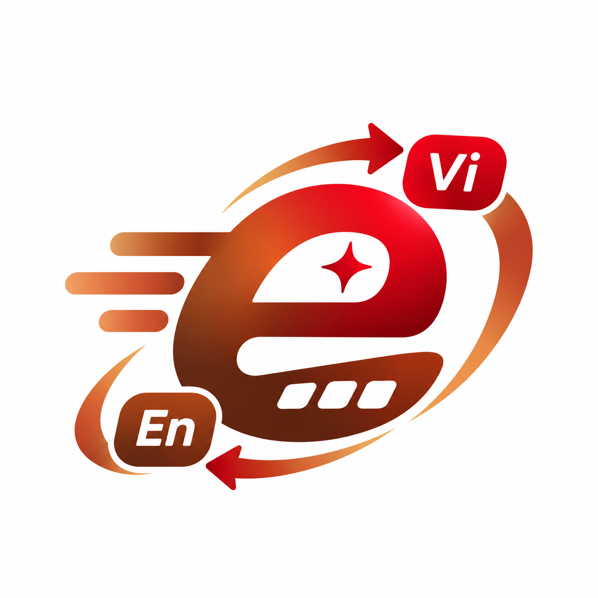
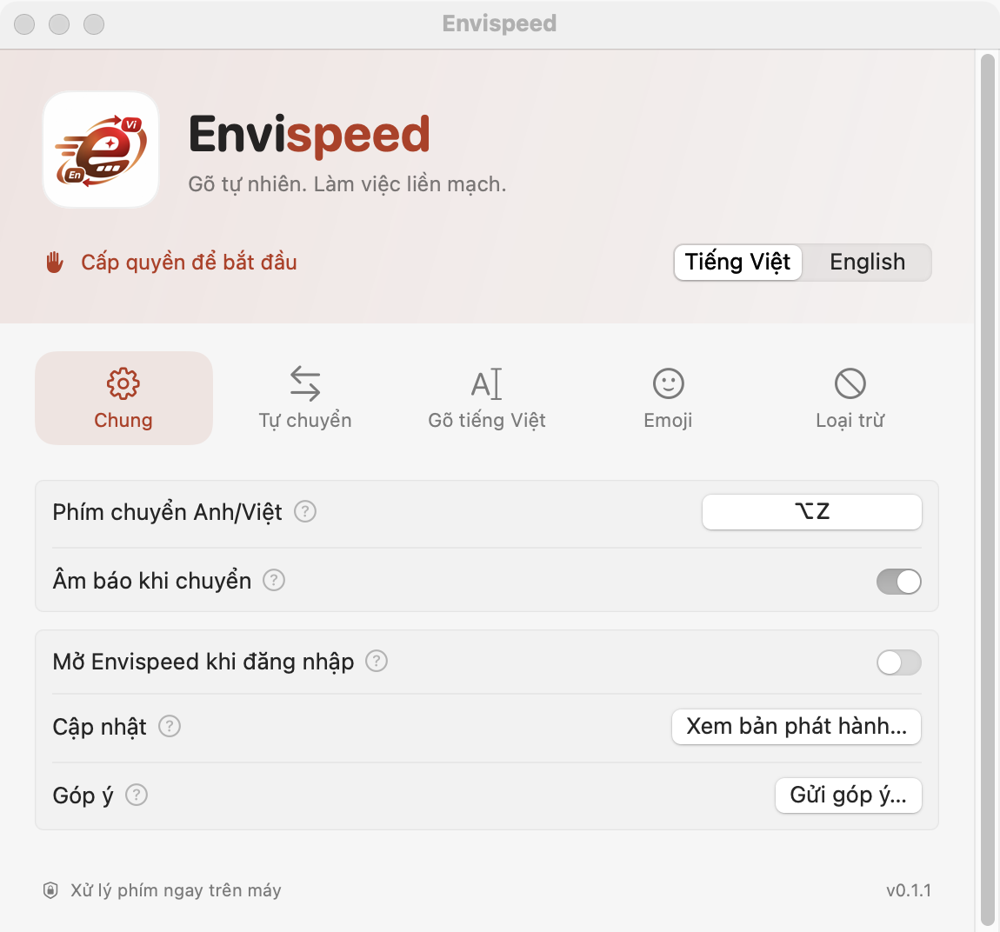

<p align="center">
  
</p>
<h1 align="center">Envispeed</h1>
<p align="center"><strong>Gõ tự nhiên. Làm việc liền mạch.</strong><br>Bộ gõ Việt / Anh cho macOS, dành cho những ngày chuyển giữa code, tài liệu và hội thoại.</p>
<p align="center">macOS 13+ · SwiftUI + C++ · GPL-3.0 · Local preview 0.1.1</p>

## Viết theo mạch suy nghĩ của bạn

Gõ Telex như thường lệ. Khi bạn chuyển giữa từ tiếng Việt và tiếng Anh, engine nhận diện ngữ cảnh để sửa từ và chuyển chế độ. Bạn vẫn có thể chọn ngôn ngữ bằng menu bar hoặc phím tắt (mặc định **⌥Z**).

- **Telex quen thuộc:** hỗ trợ Telex, Telex đơn giản 1/2 và hai cách đặt dấu `hoà` / `hòa`.
- **Việt / Anh trong một câu:** `treen` → `trên`, đồng thời nhận diện các từ tiếng Anh.
- **Dành cho công việc:** các trường hợp như `const`, `git push`, `obj.dir`, `my_var` được engine xử lý theo quy tắc có kiểm thử.
- **Nhớ ngữ cảnh:** ngôn ngữ theo ứng dụng; tùy chọn nhớ theo website cần quyền Automation của trình duyệt.
- **Chủ động hoàn tác:** bấm Delete ngay sau một lần tự sửa để hoàn tác.
- **Emoji song ngữ:** tìm bằng tiếng Việt / Anh, bật và đặt phím tắt trong Cài đặt.
- **Xử lý phím trên máy:** không cần tài khoản; bản macOS này không gửi crash report và không tự tải cập nhật.

Engine gõ, dữ liệu nhận diện và các quy tắc đã kiểm thử được giữ lại. Bản macOS local preview chưa phải DMG đã ký / notarize. Giấy phép và nguồn gốc thành phần được trình bày riêng trong [ACKNOWLEDGEMENTS.md](ACKNOWLEDGEMENTS.md).

<p align="center"></p>

## Chạy trên Mac

Cần Xcode với macOS SDK đang được chọn qua `xcode-select`. Không cần cài package, XcodeGen hay thư viện bên ngoài cho lệnh chạy local:

```sh
zsh Tools/macos/build-local.sh --run
```

App được tạo ở `build/macos/Envispeed.app`, ký ad-hoc để chạy trên máy đang build. Để build lại, thoát Envispeed từ menu bar trước. Bản local chỉ build kiến trúc của máy hiện tại.

Lần đầu mở:

1. Chọn **Bắt đầu**, rồi **Mở Cài đặt hệ thống** trong onboarding.
2. Bật **Envispeed** tại **Quyền riêng tư & Bảo mật → Trợ năng (Accessibility)**.
3. Quay lại app để thử gõ và thiết lập phím tắt. Khi thử, chỉ bật một bộ gõ tiếng Việt để tránh xử lý phím chồng nhau.

Nếu chữ ký ad-hoc thay đổi sau khi build lại và macOS không nhận quyền cũ, xóa mục Envispeed cũ trong Trợ năng, rồi thêm lại đúng app ở đường dẫn build trên. Không cần vô hiệu hóa Gatekeeper hay SIP.

Định danh: `io.github.chequanghuyca.envispeed`. Cài đặt và dữ liệu Envispeed tách riêng; app không tự lấy lịch sử gõ hoặc cài đặt của ứng dụng khác. Ghi nhật ký gõ tắt mặc định, chỉ bật trong menu **Gỡ lỗi**; nếu bật, dữ liệu lưu tại `~/Library/Application Support/Envispeed/`.

## Kiểm thử

```sh
zsh Tools/autoswitch/check.sh
zsh -n Tools/macos/build-local.sh
codesign --verify --deep --strict build/macos/Envispeed.app
```

Bộ kiểm thử có các quy tắc gõ, lỗi đã báo, golden snapshots Việt / Anh, cursor / undo và ngưỡng hiệu năng. Bộ dữ liệu nghiên cứu riêng của upstream không đi kèm nên phần đánh giá đó được bỏ qua có thông báo.

Để chụp các màn hình thật của bản Debug mà không khởi động bộ đọc phím:

```sh
build/macos/Envispeed.app/Contents/MacOS/Envispeed -renderMainWindow /tmp/envispeed-light
build/macos/Envispeed.app/Contents/MacOS/Envispeed -renderMainWindow /tmp/envispeed-dark -renderDark YES
```

Thoát app đang mở trước khi chạy các lệnh chụp. Đường dẫn `/tmp` là nơi kiểm tra ảnh, không phải ảnh mockup.

## Source và phát hành

- `App/`: ứng dụng macOS SwiftUI và cầu nối Objective-C++.
- `Engine/`: engine gõ kế thừa upstream, giữ nguyên ở bản đầu.
- `Tools/macos/`: build local và tạo các kích thước icon từ logo gốc.
- `project.yml`: cấu hình XcodeGen cho người đã có công cụ, target / scheme `Envispeed`. Signing phát hành sẽ được thiết lập sau.
- `.planning/envispeed-branding/`: phạm vi, kết quả kiểm tra và công việc còn lại.

Menu **Xem bản phát hành** mở [GitHub Releases](https://github.com/chequanghuyca/envispeed/releases). Menu **Gửi góp ý** mở [GitHub Issues](https://github.com/chequanghuyca/envispeed/issues). App không tự đính kèm nội dung gõ hay báo cáo lỗi.

Chưa đóng gói DMG, cấu hình Developer ID, notarization, update feed hoặc website riêng. Repo hiện tập trung vào macOS; không chứa pipeline phát hành của dự án khác.

## Giấy phép và ghi nhận

Phân phối theo [GPL-3.0](LICENSE). Envispeed được tùy biến bởi **chequanghuyca** từ ngày **2026-11-06**. Thông báo bản quyền của các thành phần và nguồn dữ liệu được giữ trong [ACKNOWLEDGEMENTS.md](ACKNOWLEDGEMENTS.md) và các header bản quyền tương ứng. Menu **Giấy phép & thành phần** cho phép xem thông tin pháp lý trong app.
